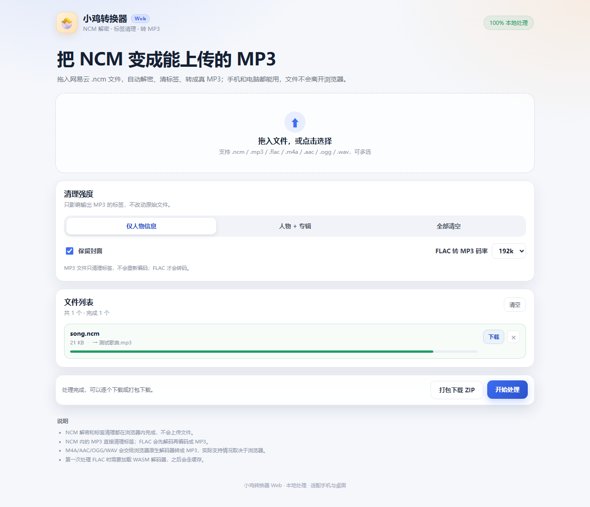
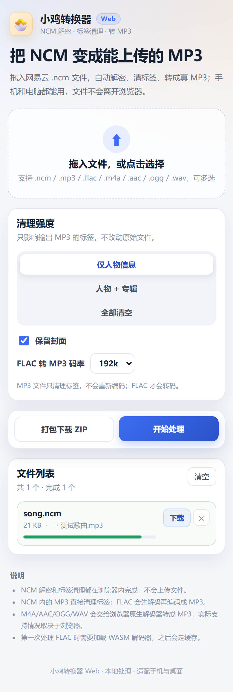

# 小鸡转换器 Web

纯前端版本：在浏览器里完成 NCM 解密、标签清理、FLAC/其他音频转 MP3，文件不会上传服务器。





## 已实现

- NCM 解析：AES-128-ECB + NCM 自有 RC4 变体解密，读取元数据与封面
- MP3：直接清理/重写 ID3 标签，不重新编码
- FLAC：WASM 解码 → lamejs 编码 MP3（可选 128/192/256/320k）
- M4A/AAC/OGG/WAV：通过浏览器原生 `AudioContext` 解码后转 MP3（取决于浏览器支持）
- 清理强度：仅人物信息 / 人物 + 专辑 / 全部清空
- 保留封面、批量处理、单个下载、ZIP 打包下载
- 响应式布局，适配桌面和手机
- 所有处理在 Web Worker 内完成，不阻塞界面

## 本地开发

```bash
cd web
npm install
npm run dev
```

打开 Vite 输出的本地地址。

## 构建

```bash
cd web
npm run build
```

产物在 `web/dist/`，纯静态文件，可直接上传到任意静态托管。

## 部署到 EdgeOne Pages

在 EdgeOne Pages 控制台创建项目，导入 GitHub 仓库 `why94666/mg_conv`：

- 项目根目录：`web`
- 构建命令：`npm ci && npm run build`
- 输出目录：`dist`

也可以在本地执行 `npm run build` 后，用「直接上传」把 `web/dist` 上传。

## 部署到 GitHub Pages

仓库已包含 [`.github/workflows/pages.yml`](../.github/workflows/pages.yml)，推送到 `main` 会自动构建并部署。

第一次使用需要在仓库设置里开启一次：

1. 打开 `https://github.com/why94666/mg_conv/settings/pages`
2. Build and deployment → Source 选择 **GitHub Actions**
3. 推送 `main`（或手动运行 `Deploy Web to GitHub Pages` workflow）

部署地址：

```text
https://why94666.github.io/mg_conv/
```

## 测试

```bash
cd web
npm test
```

测试覆盖：

- 合成 NCM → 预期 FLAC 字节逐字节对比
- NCM 内 MP3 → 标签清理、帧完整性
- FLAC → PCM → MP3 真实编码
- FLAC NCM → MP3 完整流程

## 技术栈

- Vite + React + TypeScript
- Web Worker + `@wasm-audio-decoders/flac` + `@breezystack/lamejs`
- `aes-js`、`browser-id3-writer`、`jszip`

## 限制

- NCM 内部是 MP3 或 FLAC 时支持最好；NCM 内是 M4A 等容器时暂未接入解密后的浏览器解码流程。
- M4A/AAC/OGG/WAV 的原生解码依赖浏览器；Chrome/Edge/Safari 对 AAC/M4A 支持较好。
- 大文件（尤其长 FLAC）会占用较多内存，建议在桌面浏览器处理超大文件。
